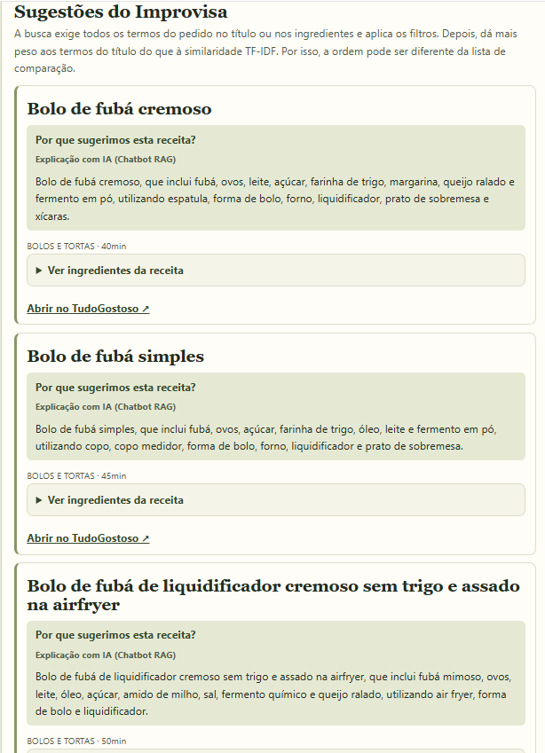
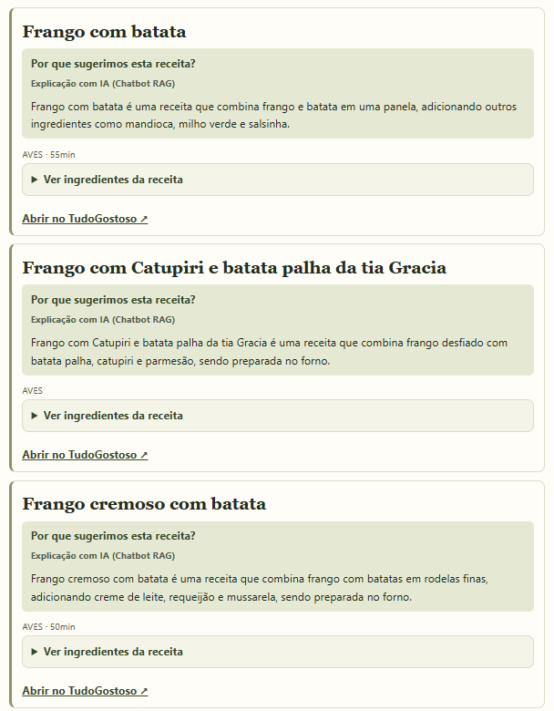
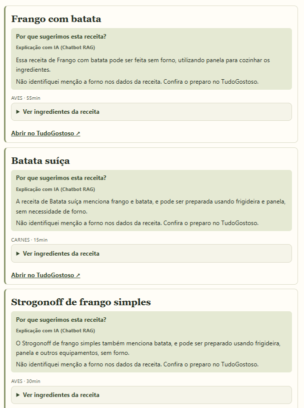
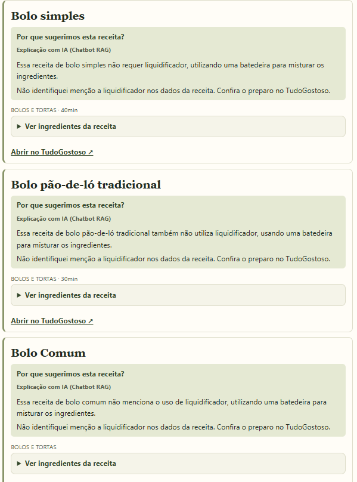
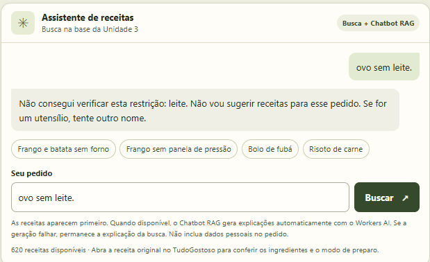

# Avaliação do Chatbot RAG — Workers AI

Este documento complementa o [README da Unidade 4](../README.md) com os testes manuais da geração de explicações na aplicação publicada: [Improvisa](https://improvisa.receitas-pln.workers.dev/).

## Objetivo e funcionamento avaliado

O Improvisa recupera receitas de uma base de 620 registros e utiliza RAG (*Retrieval-Augmented Generation*) para explicar as sugestões. A **busca guiada** escolhe e ordena as receitas; o **Cloudflare Workers AI**, com o modelo **Llama 3.3 70B Instruct FP8 Fast** (`@cf/meta/llama-3.3-70b-instruct-fp8-fast`), recebe informações das receitas selecionadas e gera um texto associado a cada cartão. O modelo não escolhe quais receitas serão exibidas.

As receitas aparecem inicialmente com uma explicação padrão. Quando a geração funciona, o texto é substituído pela indicação **“Explicação com IA (Chatbot RAG)”**. Se a geração não estiver disponível, a busca e o texto padrão continuam funcionando.

## Procedimento dos testes

Foram realizadas **cinco consultas manuais** na versão publicada, observando os três primeiros cartões de cada busca, quando disponíveis. As capturas de tela registram o conteúdo que apareceu na interface. Foram observados a geração efetiva das explicações, sua relação com o pedido, a clareza do texto e possíveis afirmações que excedem os dados recuperados.

Esta avaliação é **qualitativa e exploratória**: não utilizou avaliadores independentes nem uma conferência integral dos modos de preparo originais. Os testes automatizados do projeto verificam a integração, a estrutura das respostas e a associação dos identificadores às receitas, mas não demonstram, por si só, a correção factual de todos os textos gerados.

## Resultados observados

| Consulta | Comportamento observado | Análise |
| --- | --- | --- |
| `bolo fubá` | O RAG gerou explicações nos três cartões apresentados. | As explicações mencionaram ingredientes e equipamentos, mas ficaram próximas de uma enumeração, com pouco esclarecimento sobre o motivo da sugestão. |
| `frango com batata` | O RAG gerou explicações nos três cartões. | Os textos relacionaram frango e batata às receitas. Um dos resultados envolvia **batata palha**, mostrando uma limitação da recuperação lexical. |
| `frango e batata sem forno` | O RAG gerou explicações nos três cartões. | Alguns textos afirmaram que as receitas poderiam ser preparadas **sem forno**. A ausência de menção ao equipamento nos dados recuperados não é suficiente para garantir isso. |
| `bolo sem liquidificador` | O RAG gerou explicações nos três cartões. | Alguns textos disseram que as receitas **não requerem** liquidificador, embora os registros permitam afirmar apenas que não foi encontrada menção a ele. |
| `ovo sem leite` | A aplicação não apresentou sugestões e informou que não conseguia verificar a restrição `leite`. | Foi uma decisão da **etapa de busca**, anterior à geração: não houve explicação RAG nem receita apresentada como compatível. |

Nas quatro consultas com resultados, as capturas mostram **12 cartões com explicações identificadas como geradas por IA** (três por consulta). Isso comprova a exibição dessas respostas nos casos registrados, mas **não é uma taxa de acerto** nem demonstra que todas as afirmações sejam corretas.

## Evidências da aplicação

### 1. Busca por bolo de fubá

**Figura 1 —** Explicações do Workers AI para receitas relacionadas a `bolo fubá`. Os textos incluem informações das receitas, mas se aproximam de listas de ingredientes e utensílios.

### 2. Busca por frango com batata

**Figura 2 —** O modelo explica a relação com os termos pesquisados. O resultado com batata palha evidencia que a correspondência de palavras nem sempre distingue variantes de ingredientes.

### 3. Pedido com restrição de forno

**Figura 3 —** O RAG gerou explicações, mas algumas afirmaram compatibilidade com a restrição de forno sem comprovação suficiente nos dados analisados.

### 4. Pedido com restrição de liquidificador

**Figura 4 —** Algumas explicações interpretaram a ausência de menção a liquidificador como confirmação de que ele não seria necessário.

### 5. Restrição não suportada

**Figura 5 —** Diante de `ovo sem leite`, a etapa de busca informa que não consegue verificar essa restrição e deixa de recomendar receitas. Esse caso não representa uma resposta gerada pelo modelo de linguagem.

## Discussão e limitações

A integração com o Workers AI acrescentou explicações específicas aos resultados da busca sem modificar a seleção das receitas. Nos exemplos observados, foi possível associar o texto ao cartão correspondente. Entretanto, a utilidade das explicações variou: algumas apenas listaram características da receita, enquanto outras fizeram afirmações mais fortes do que os dados disponíveis permitem.

O ponto mais importante apareceu nas restrições de equipamentos. **Não encontrar a palavra “forno” ou “liquidificador” nos dados analisados não comprova que a receita dispense o equipamento.** A própria instrução do modelo recomenda cautela, mas os exemplos demonstram que essa orientação nem sempre foi seguida. Além disso, o servidor valida o formato e os IDs das explicações, não a veracidade de cada afirmação.

A consulta `ovo sem leite` demonstrou uma proteção da **busca guiada**, não uma capacidade do RAG de verificar ingredientes ausentes. O sistema se recusou a recomendar receitas porque não consegue validar essa restrição por meio dos filtros implementados.

Para aprimorar o projeto, seria útil ampliar a amostra de consultas, conferir manualmente as explicações com as receitas originais, medir quantas afirmações têm apoio nas fontes, diferenciar ingredientes comuns de variantes como batata palha e desenvolver validações mais específicas para restrições de equipamentos.

## Como reproduzir

1. Execute `npm test` na pasta `Unidade_04` para verificar os testes automatizados de busca e integração.
2. Acesse a [aplicação publicada](https://improvisa.receitas-pln.workers.dev/) e faça as cinco consultas da tabela.
3. Verifique se os cartões exibem o rótulo **“Explicação com IA (Chatbot RAG)”** antes de considerar um texto como resposta do Workers AI. Quando o texto padrão é mantido, a geração não foi confirmada naquele caso.
4. Compare as explicações com os ingredientes e, quando necessário, com o preparo original no TudoGostoso.

As respostas generativas podem variar entre execuções e dependem da disponibilidade e da cota do serviço. Por isso, os textos apresentados nas figuras representam **as execuções registradas**, não respostas fixas garantidas para buscas futuras.
